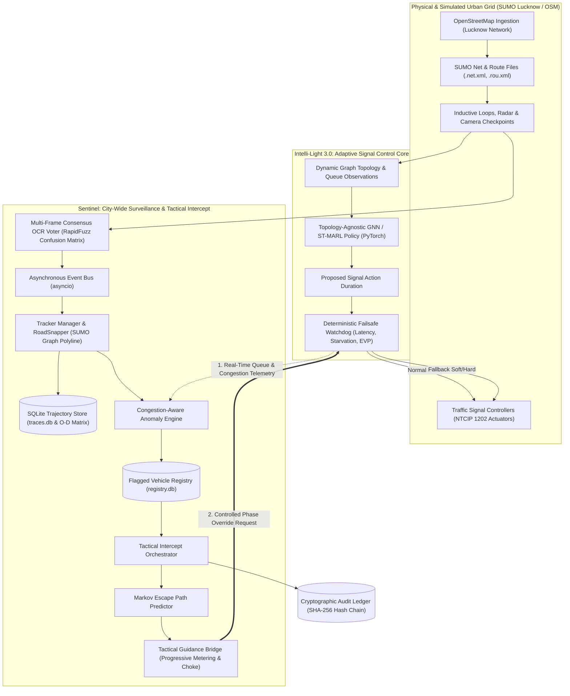

# 🚦 Intelli-Light 3.0 & Sentinel: Autonomous Urban Mobility & City-Wide Surveillance Platform

> **Universal Adaptive Traffic Signal Control (GAT + LSTM Spatio-Temporal MARL, SUMO, NTCIP 1202) alongside City-Wide ANPR Trajectory Tracking, Congestion-Aware Anomaly Detection, and Tactical Traffic Intercept Orchestration.**  
> **Platform Architect:** KSHITIZ (Pinaka Studios)  
> **Target Problem Statements:** Complex Urban Mobility Optimization & SIH26127 / Bharat Electronics Limited (BEL)

---

## 🌟 Executive Summary

This repository houses two complementary, production-engineered intelligent transportation systems:

1. **Intelli-Light 3.0**: An adaptive, multi-agent traffic signal control platform designed to eliminate heavy congestion, unfair starvation, and emergency vehicle delays across chaotic urban grids (modeled after Indian metropolitan networks such as Lucknow). By employing **Graph Neural Networks (GNN)**, **Spatio-Temporal MARL (GAT + LSTM)**, and **NTCIP 1202 SNMP Hardware Controllers** wrapped in a **Deterministic Failsafe Watchdog**, Intelli-Light achieves topology-agnostic signal coordination across non-standard 3-way, 4-way, 5-way, and 6-way intersections.

2. **Sentinel**: An autonomous, city-wide surveillance and traffic intelligence layer operating alongside Intelli-Light (targeting problem statement **SIH26127** for **Bharat Electronics Limited**). Sentinel ingests distributed ANPR camera sightings, denoises optical reads via multi-frame consensus voting with fuzzy OCR substitution tolerance, reconstructs road-snapped vehicle trajectories, detects evasive behavior using live GNN congestion telemetry, and provides non-violent traffic intercept orchestration with emergency vehicle preemption and cryptographic audit logging.

---

## 🏛️ System Architecture & Interaction



> [!NOTE]
> For complete technical diagrams, flowcharts, sequence diagrams, class models, and state machines, see [`docs/SYSTEM_ARCHITECTURE_AND_DIAGRAMS.md`](docs/SYSTEM_ARCHITECTURE_AND_DIAGRAMS.md).

---

## 🛡️ Architectural Separation of Concerns

* **Intelli-Light Independence**: Intelli-Light operates as a standalone production traffic controller. It optimizes traffic flow, clears lane backlogs, balances queue pressures, and coordinates green waves across the city. It requires zero knowledge of vehicle identities.
* **Sentinel Decoupled Layer**: Sentinel operates as an asynchronous intelligence layer. It reads road graphs and real-time congestion telemetry via [`sentinel/anomaly/gnn_bridge.py`](sentinel/anomaly/gnn_bridge.py) to evaluate route justifications.
* **Safety-Regulated Actuation**: Sentinel interacts with physical signals **only** via authorized phase override requests passed through [`sentinel/intercept/failsafe_bridge.py`](sentinel/intercept/failsafe_bridge.py) into Intelli-Light's [`deployment/failsafe.py`](deployment/failsafe.py). Sentinel never mutates neural network weights or core reinforcement learning loops.

---

## 🔥 Key Features & Capabilities

### 🧠 1. Intelli-Light 3.0: Graph Neural Networks & ST-MARL Core
* **Topology-Agnostic GCN ([`models/gnn_extractor.py`](models/gnn_extractor.py))**: PyTorch-based Graph Convolutional Network feature extractor that dynamically aggregates $N$-hop neighborhood states across variable-degree road networks.
* **Spatio-Temporal Graph Attention ([`models/st_marl_model.py`](models/st_marl_model.py))**: Combines Graph Attention Networks (GAT) to dynamically weigh incoming traffic from adjacent nodes with an LSTM temporal sequence model to capture queue accumulation trends over past timesteps.
* **Multi-Agent Parameter Sharing (ILPS)**: Scalable Multi-Agent Reinforcement Learning (MARL) enabling coordinated signal control across arbitrary city topologies without exploding observation spaces.

### ⚖️ 2. Production Multi-Factor Reward Calculator ([`rl/reward_function.py`](rl/reward_function.py))
* **Exponential Anti-Starvation Penalty**: Penalizes wait times exceeding 60 to 90 seconds exponentially ($-8.0 \times \text{excess}^{1.3}$), ensuring no vehicle is stranded indefinitely.
* **Emergency Vehicle Preemption (EVP)**: $+100.0$ bonus for immediate emergency vehicle clearance and $-200.0$ penalty if delayed.
* **Green-Wave Coordination**: $+3.0$ bonus when adjacent intersections synchronize green phases along major arterial corridors.
* **Max-Pressure Stabilization**: Integrates pressure differentials between upstream and downstream queues to stabilize reinforcement learning convergence.

### 🛡️ 3. Deterministic Failsafe Engine & Hardware Integration
* **NTCIP 1202 Standard Controller ([`deployment/controller.py`](deployment/controller.py))**: Native SNMP communication implementing NTCIP 1202 OIDs (`phaseControlGroupHold`, `phaseControlGroupForceOff`, `phaseStatusGroupGreen`) for direct hardware interfacing with Siemens, Econolite, and Yunex traffic signal cabinets.
* **Shadow Mode Operations**: Run AI predictions in passive observation mode to build municipal trust prior to live actuation.
* **Deterministic Watchdog ([`deployment/failsafe.py`](deployment/failsafe.py))**: Hardware safety layer evaluating inference latency ($<0.5\text{s}$), queue capacity, max wait thresholds ($>120\text{s}$), and heartbeat timeouts ($2.0\text{s}$) to transition between `NORMAL`, `FALLBACK_SOFT` (fixed-timer), and `FALLBACK_HARD` (flashing hardware mode).

### 🛰️ 4. Sentinel: Multi-Frame ANPR & Consensus Voting ([`sentinel/alpr/`](sentinel/alpr/))
* **Multi-Frame Consensus OCR Voter ([`sentinel/alpr/voter.py`](sentinel/alpr/voter.py))**: Denoises optical plate reads across rolling video frames (`VOTE_WINDOW = 3`) to eliminate single-frame camera noise.
* **RapidFuzz Substitution Tolerance**: Uses fuzzy character token matching to resolve common Indian license plate OCR confusion pairs (`0/D`, `1/I`, `8/B`, `5/S`).

### 🗺️ 5. Spatial-Temporal Trajectory Tracking & Road Snapping ([`sentinel/tracker/`](sentinel/tracker/))
* **Physical Road Snapping ([`sentinel/tracker/road_snapper.py`](sentinel/tracker/road_snapper.py))**: Rather than rendering straight lines between camera checkpoints, Sentinel traverses the SUMO physical edge graph to extract exact polyline geometries (`GeoJSON LineString`).
* **Kinematic Plausibility Watchdog**: Verifies transition velocity between sequential sightings ($v \le 30 \text{ m/s}$), immediately flagging cloned plates or sensor teleportation anomalies.
* **Persistent Trajectory Store ([`sentinel/tracker/trajectory_store.py`](sentinel/tracker/trajectory_store.py))**: Thread-safe SQLite backend (`traces.db`) storing sightings, active trajectories, and real-time Origin-Destination (O-D) mobility matrices.

### 🔍 6. GNN Congestion-Aware Anomaly Engine ([`sentinel/anomaly/`](sentinel/anomaly/))
Traditional surveillance systems flag any deviation from a vehicle's shortest path as suspicious, leading to false alarms during rush hours when commuters divert around traffic jams. Sentinel cross-references route deviations with **Intelli-Light's live GNN congestion telemetry**:
$$\text{Detour Justification} = f(\text{Queue}_{\text{bypassed}}, \text{Pressure}_{\text{bypassed}})$$
$$\text{Adjusted Detour Score} = \text{Deviation Ratio} \times (1.0 - \text{Detour Justification})$$
* **Traffic Jam Bypass**: If an intersection with a queue $\ge 25$ vehicles is bypassed, the detour is recognized as rational commute avoidance ($\text{Score} = 0.0$).
* **Suspicious Evasion**: If a driver takes a circuitous detour around completely empty roads ($\text{Queue} \le 3$), Sentinel detects the evasion and raises a threat alarm ($\text{Score} > 0.65$).

### 🛑 7. Tactical Traffic Intercept Orchestrator ([`sentinel/intercept/`](sentinel/intercept/))
When an authorized operator authorizes an intercept:
1. **Markov Path Predictor ([`sentinel/intercept/predictor.py`](sentinel/intercept/predictor.py))**: Forecasts downstream candidate escape intersections based on network topology transitions and vehicle heading.
2. **Tactical Guidance Bridge ([`sentinel/intercept/tactical_bridge.py`](sentinel/intercept/tactical_bridge.py))**: Progressively transitions through tactical stages (`METERING`, `CHOKE`, `FUNNEL`, `CONTAINMENT`) to kinematically slow down the suspect using natural vehicle queues rather than sudden software stops.
3. **Emergency Preemption Bridge ([`sentinel/intercept/failsafe_bridge.py`](sentinel/intercept/failsafe_bridge.py))**: Automatically suspends intercept overrides if an emergency vehicle (ambulance or fire) is present, enforces pedestrian minimum clearance intervals ($\ge 15\text{s}$), and auto-expires intercept missions after their TTL ($600\text{s}$).
4. **Tamper-Evident SHA-256 Audit Trail ([`sentinel/data/audit.jsonl`](sentinel/data/audit.jsonl))**: Every tracking activation, alert, and signal override writes an append-only JSON record with cryptographic hash chaining ($H_i = \text{SHA256}(D_i \parallel H_{i-1})$) for legal non-repudiation.

---

## 📂 Repository Structure

```text
Intelli-Light/
├── main.py                     # Unified CLI entrypoint for all Intelli-Light & Sentinel tasks
├── run_gui.bat                 # One-click launcher for Sentinel + Intelli-Light interactive GUI
├── pinaka.json                 # Project configuration metadata
├── requirements.txt            # System dependencies
│
├── configs/                    # System configurations, signal timings, and parameters
│
├── deployment/                 # Physical hardware deployment and safety guardrails
│   ├── controller.py           # NTCIP 1202 SNMP hardware bridge & Shadow Mode
│   └── failsafe.py             # FailsafeWatchdog state machine (NORMAL / SOFT / HARD fallback)
│
├── docs/                       # Technical whitepapers and architectural diagrams
│   ├── SYSTEM_ARCHITECTURE_AND_DIAGRAMS.md # 10 comprehensive Mermaid architecture diagrams
│   ├── SENTINEL_SIH26127_ARCHITECTURE.md   # SIH26127 BEL compliance whitepaper
│   └── INTELLI_LIGHT_3_GNN_MANIFESTO.md    # GNN & deterministic failsafe design manifesto
│
├── models/                     # Deep Learning neural feature extractors
│   ├── gnn_extractor.py        # PyTorch SimpleGCNLayer & GNNExtractor
│   ├── st_marl_model.py        # Spatio-Temporal GAT + LSTM Feature Extractor
│   └── override_log.py         # Logging and model override utilities
│
├── rl/                         # Gymnasium Environments & Reward logic
│   ├── sumo_gnn_env.py         # SUMO Graph-based multi-agent environment (topology discovery)
│   ├── multi_agent_env.py      # Multi-agent traffic corridor environment
│   ├── reward_function.py      # EnhancedRewardCalculator (starvation, EVP, green wave)
│   ├── gnn_env.py              # Architecture prototype Gym environment
│   └── sumo_gnn_randomized_env.py # Environment with domain randomization
│
├── sentinel/                   # Sentinel: City-Wide Surveillance & Intercept Engine
│   ├── config.py               # Thresholds, timings, and configuration constants
│   ├── demo.py                 # Turnkey 60-second command-line demonstration scenario
│   ├── gui_demo.py             # Dual-viewport real-time SUMO-GUI interactive demonstration
│   ├── intellilight_controller.py # Real-time adaptive Max-Pressure signal controller
│   ├── registry.py             # FlaggedVehicleRegistry (SQLite watchlist & authorizations)
│   ├── server.py               # FastAPI GIS surveillance server with live WebSockets
│   ├── alpr/                   # Multi-frame consensus OCR voter & confusion tolerance
│   ├── anomaly/                # Congestion-aware anomaly scorer & GNN telemetry bridge
│   ├── data/                   # SQLite stores (registry.db, traces.db) and audit.jsonl
│   ├── ingestion/              # Event bus and SUMO camera grid injectors
│   ├── intercept/              # Intercept orchestrator, Markov predictor, and failsafe bridge
│   ├── static/                 # GIS map web dashboard assets (Leaflet & HUD)
│   ├── tests/                  # 82 automated pytest unit and integration tests
│   └── tracker/                # Trajectory store, road snapper, and vehicle trace models
│
├── simulation/                 # SUMO lifecycle, traffic & map generators
│   ├── generate_lucknow.py     # OpenStreetMap downloader & compiler for Lucknow network
│   ├── realistic_traffic.py    # Time-of-day demand & random traffic event generator
│   ├── sumo_env.py             # Core SUMO TraCI lifecycle wrapper
│   └── lucknow_map/            # Lucknow network (.net.xml), routes (.rou.xml), and sumocfg
│
├── training/                   # Model training, evaluation & explainability
│   ├── baseline_controllers.py # Max-Pressure, Surtrac-Like & Fixed-Timer baselines
│   ├── evaluate_gnn.py         # GNN policy evaluation diagnostics
│   ├── run_gnn_gui.py          # Standalone Intelli-Light SUMO GUI visualizer
│   ├── train_gnn.py            # GNN model training script
│   ├── train_st_marl.py        # Spatio-Temporal MARL training script
│   └── xai_engine.py           # Explainable AI natural language reasoning engine
│
└── webapp/                     # Standalone Intelli-Light Web Dashboards
    ├── main.py                 # FastAPI backend with async Redis WebSockets
    ├── dashboard_backend.py    # Live SUMO simulation telemetry service
    ├── static/                 # 2D Web Dashboard assets
    └── 3d-dashboard/           # Modern 3D React + Three.js Graph Visualizer
```

---

## ⚡ Quick Start & Execution Guide

### Prerequisites
* **Python 3.10+** (Tested on Python 3.13)
* **Eclipse SUMO 1.20+**: Ensure `SUMO_HOME` environment variable is set (or use the built-in virtualenv SUMO binary).

### 1. Installation
```powershell
git clone https://github.com/KshitizD07/demo_intellilight.git
cd demo_intellilight
.\venv\Scripts\python.exe -m pip install -r requirements.txt
```

---

## 💻 Operating Modes & Demonstrations

### Mode 1: Interactive Unified Dual-View SUMO Demonstration (Recommended)
Visualizes both Intelli-Light's adaptive Max-Pressure queue balancing and Sentinel's tactical red-wall intercept inside SUMO-GUI.

Run the pre-configured batch script:
```powershell
.\run_gui.bat
```
Or execute directly via CLI with custom traffic scale and step delay:
```powershell
.\venv\Scripts\python.exe main.py sentinel-gui --scale 5.0 --delay 400
```
* **View #0**: Global traffic overview centered at `(5580, 6400)` displaying dense 5x traffic and dynamically adapting traffic signals.
* **View #1**: Dedicated Sentinel surveillance HUD tracking the suspect vehicle (`UP32XY9999` in bright red).
* **Interactive Control**: Press **`[SPACE]`** or **`[R]`** in your terminal anytime to deploy the Red-Wall. Downstream signals switch to all-red, a civilian queue forms ahead, the suspect halts naturally under Krauss physics, the suspect is apprehended, and Intelli-Light clears the backlog.
* **Performance Scorecard**: Automatically printed upon completion.

---

### Mode 2: Standalone Intelli-Light Graphical Simulation (No Sentinel)
Runs purely Intelli-Light's GNN graph-based environment with deterministic starvation failsafes on the Lucknow network with zero Sentinel involvement:
```powershell
.\venv\Scripts\python.exe main.py gnn-gui
```
*(Use the **Delay (ms)** input box in the SUMO-GUI toolbar to set playback speed to 200–400 ms).*

---

### Mode 3: Sentinel Turnkey 60-Second Command-Line Scenario
Executes a fully automated, self-contained demonstration validating ANPR consensus voting, normal commute baseline, GNN congestion-adjusted detour anomaly detection, and red-wall intercept:
```powershell
.\venv\Scripts\python.exe main.py sentinel-demo
```

---

### Mode 4: Sentinel Live Real-Time Web GIS Surveillance Dashboard
Launches the Sentinel web intelligence dashboard with interactive Leaflet GIS mapping, live WebSocket feeds, route breadcrumbs, active intercepts, and Origin-Destination matrices:
```powershell
.\venv\Scripts\python.exe main.py sentinel-web --port 8888
```
Open your browser at: **`http://localhost:8888`**

---

### Mode 5: Standalone Intelli-Light Web Telemetry Server
Launches the standalone Intelli-Light FastAPI telemetry server:
```powershell
.\venv\Scripts\uvicorn.exe webapp.main:app --port 8000
```
Open your browser at: **`http://localhost:8000`**

---

## 🧪 Automated Test Suite

Sentinel and Intelli-Light include a comprehensive pytest test suite covering the ALPR consensus voter, SQLite trajectory store, GNN telemetry bridge, failsafe watchdog bridge, tactical guidance bridge, and FastAPI servers.

Run all tests:
```powershell
.\venv\Scripts\python.exe -m pytest sentinel/tests/ -v
```
*Status: **82 passed**, 0 failed.*

---

## 📊 Baseline Benchmarks & Evaluation

Intelli-Light implements standard adaptive traffic control algorithms for benchmarking:
1. **Max-Pressure Controller ([`training/baseline_controllers.py`](training/baseline_controllers.py))**: Industry-standard Varaiya (2013) algorithm serving approaches with maximum queue differential pressure.
2. **Surtrac-Like Controller**: Schedule-driven cluster discharge algorithm allocating green time based on approaching vehicle cluster estimates.
3. **Fixed-Timer Controller**: Traditional static cycle baseline.

To evaluate GNN policies against baselines:
```powershell
.\venv\Scripts\python.exe -m training.evaluate_gnn
```

---

## 📖 Architectural Whitepapers & Documentation

For in-depth theoretical specifications, refer to the documentation in [`docs/`](docs/):
* [`docs/SYSTEM_ARCHITECTURE_AND_DIAGRAMS.md`](docs/SYSTEM_ARCHITECTURE_AND_DIAGRAMS.md): 10 detailed Mermaid diagrams covering system design, GNN inference, ANPR pipeline, anomaly detection, intercept sequence, state machines, and entity schemas.
* [`docs/SENTINEL_SIH26127_ARCHITECTURE.md`](docs/SENTINEL_SIH26127_ARCHITECTURE.md): Complete SIH26127 / Bharat Electronics Limited compliance whitepaper.
* [`docs/INTELLI_LIGHT_3_GNN_MANIFESTO.md`](docs/INTELLI_LIGHT_3_GNN_MANIFESTO.md): GNN design rationale and deterministic failsafe safety manifesto.

---

## 📜 License & Attribution

Designed and architected by **KSHITIZ** (Pinaka Studios).  
Licensed under the terms of the [`LICENSE`](LICENSE) file.
