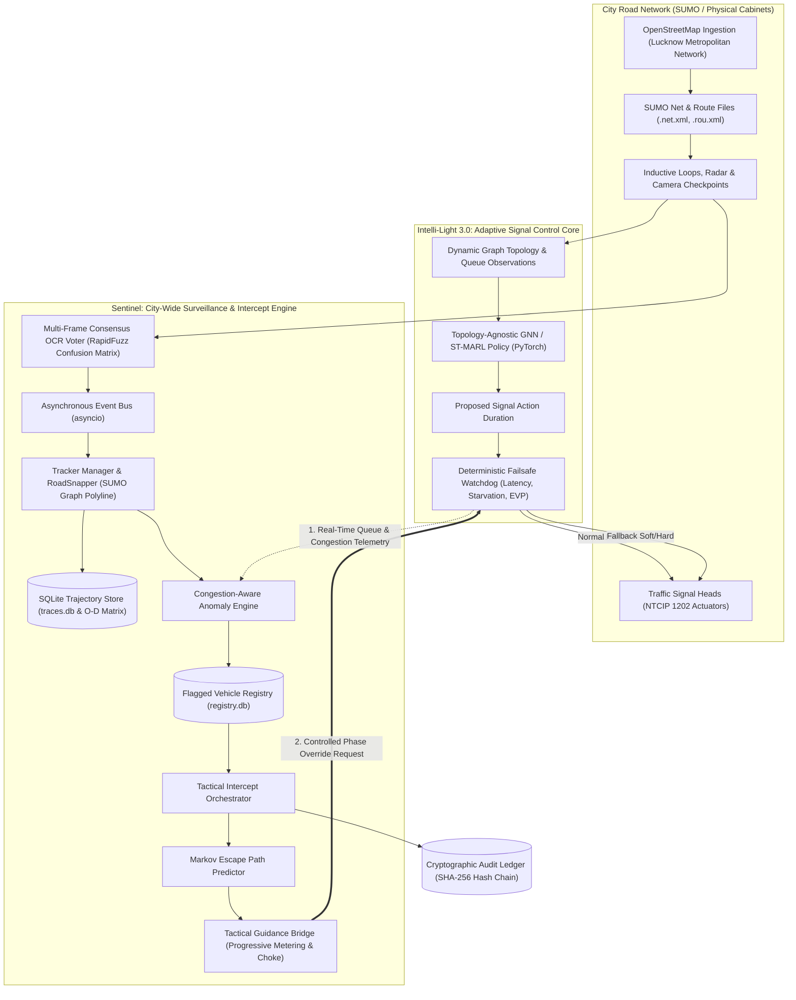
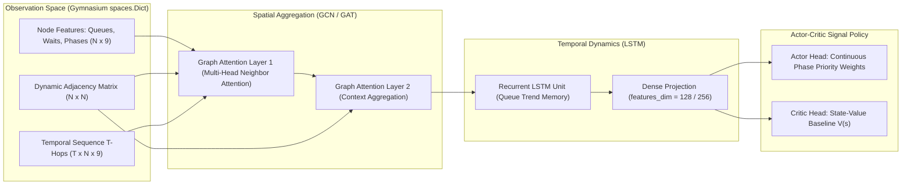
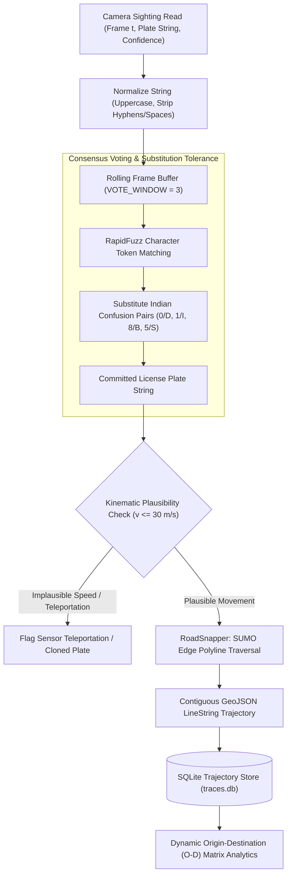
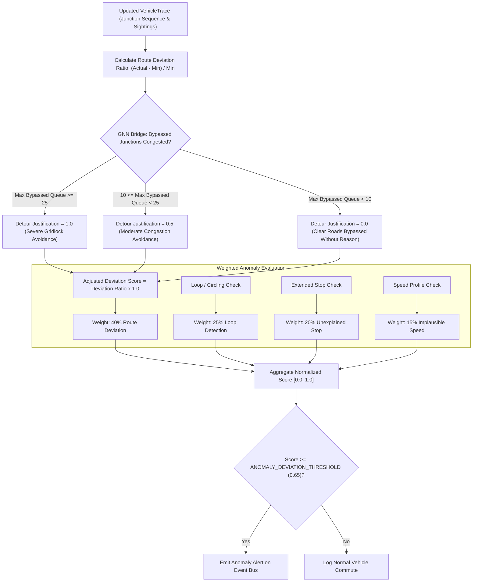
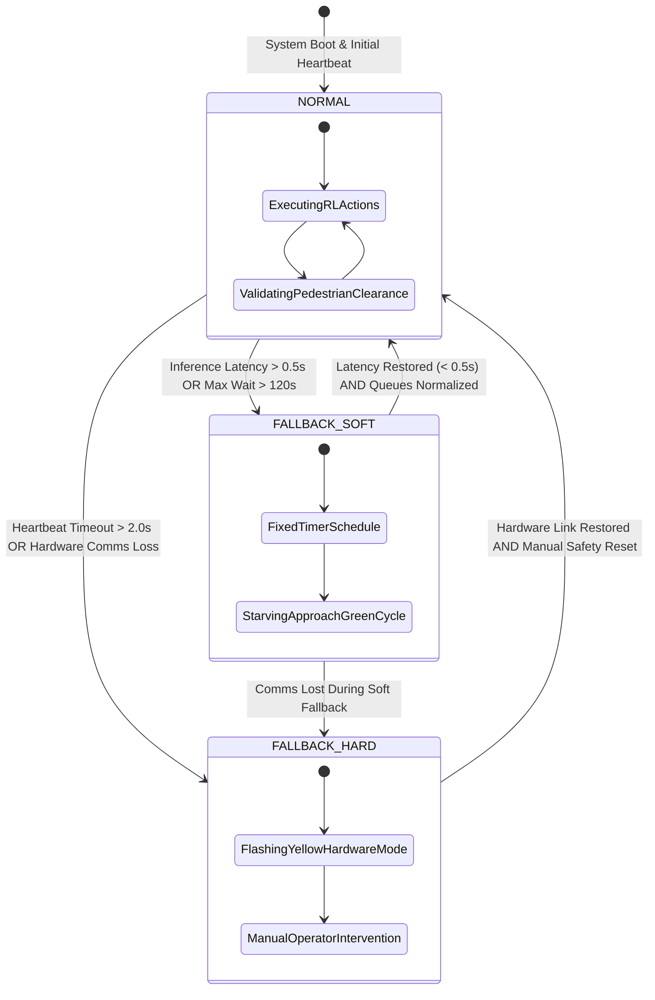
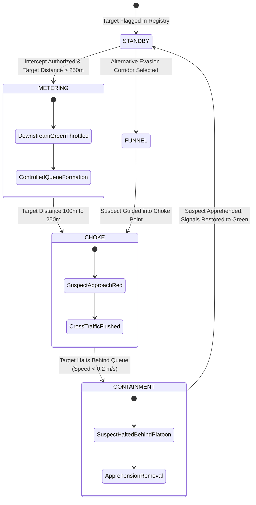
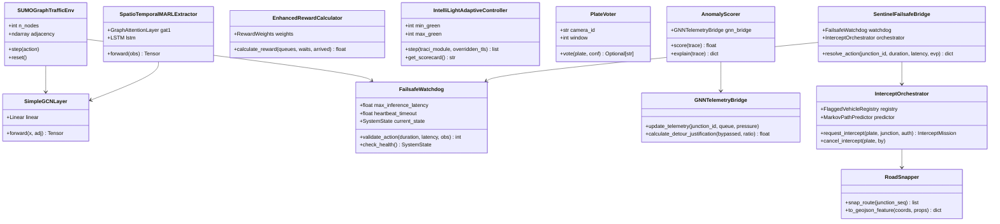
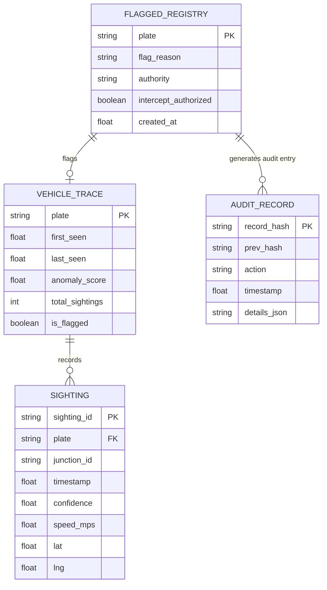

# System Architecture, Technical Design & Workflow Diagrams

> **Platforms:** Intelli-Light 3.0 & Sentinel  
> **Platform Architect:** KSHITIZ (Pinaka Studios)  
> **Target Problem Statements:** Urban Traffic Optimization & SIH26127 / Bharat Electronics Limited (BEL)

---

## 1. High-Level System Architecture

This diagram visualizes the macroscopic interaction between the physical or simulated city network (SUMO Lucknow), the autonomous traffic signal controller (**Intelli-Light 3.0**), and the surveillance and tactical intercept layer (**Sentinel**).



---

## 2. Intelli-Light 3.0: Spatio-Temporal GNN & MARL Pipeline

This diagram shows how spatial connectivity (GCN/GAT) and temporal queue memory (LSTM) extract topology-invariant representations of complex multi-leg intersections.



---

## 3. Sentinel: High-Accuracy Multi-Frame ANPR & Tracking Pipeline

This diagram illustrates how raw camera sightings are denoised, validated, snapped to real roadways, and verified against physical vehicle dynamics.



---

## 4. GNN Congestion-Aware Route Anomaly Scoring Flow

The key innovation of Sentinel: evaluating whether a vehicle detour was rational or suspicious by querying Intelli-Light's live congestion state.



---

## 5. Tactical Intercept Handshake & Queue Containment Sequence

This sequence diagram depicts the end-to-end communication lifecycle when an operator authorizes a tactical red-wall intercept on a flagged target vehicle.

```mermaid
sequenceDiagram
    autonumber
    actor Operator as Operator (Lucknow Police ICCC)
    participant Sentinel as Sentinel Orchestrator
    participant Markov as Markov Path Predictor
    participant Bridge as Tactical Guidance Bridge
    participant Failsafe as Failsafe Watchdog & EVP Bridge
    participant Controller as Intelli-Light Adaptive Controller
    participant SUMO as SUMO Microscopic Network

    Operator->>Sentinel: Request Intercept (Plate: UP32XY9999, Mission: M-104)
    Sentinel->>Sentinel: Validate Token & Flagged Registry Entry
    Sentinel->>Markov: Predict Target Escape Corridor
    Markov-->>Sentinel: Downstream Target Junction: cluster_11823984553
    Sentinel->>Bridge: Deploy Tactical Containment Plan
    Bridge->>Failsafe: Request Signal Phase Override (ALL-RED Hold, TTL = 600s)
    
    alt Emergency Vehicle Present on Approach (EVP Active)
        Failsafe-->>Bridge: REJECT / SUSPEND (Emergency Vehicle Green Priority Clearance)
    else Safety Envelope Satisfied
        Failsafe->>Controller: Register Overridden TLS ID
        Controller->>Controller: Yield Target Junction Control to Sentinel
        Failsafe->>SUMO: Execute Traffic Light ALL-RED (Downstream Stop Line)
        Note over Controller,SUMO: Intelli-Light continues adaptive Max-Pressure on all other junctions
        SUMO->>SUMO: Lead civilian halts at stop line; civilian queue builds
        SUMO->>SUMO: Suspect decelerates behind queue via native Krauss car-following
        SUMO-->>Sentinel: Suspect velocity drops to 0.0 m/s (Halted for >= 3s)
        Sentinel->>Operator: APPREHENSION SUCCESSFUL (Suspect Boxed In)
        Sentinel->>SUMO: Remove Suspect Vehicle (Option A Apprehension)
        Sentinel->>Controller: Release TLS Override (Restore Program 0)
        Controller->>SUMO: Trigger Adaptive Green Extension (Disperse Civilian Queue)
    end
    Sentinel->>Sentinel: Append SHA-256 Hash Chained Record to audit.jsonl
```

---

## 6. Deterministic Failsafe Watchdog State Machine

This state diagram details how the hardware watchdog in [`deployment/failsafe.py`](file:///C:/Users/kshit/cs/project/Intelli-Light/deployment/failsafe.py) maintains physical safety boundaries and protects against software or communication failures.



---

## 7. Tactical Intercept Stages State Machine

This state diagram illustrates the progression of tactical stages defined in [`sentinel/intercept/tactical_bridge.py`](file:///C:/Users/kshit/cs/project/Intelli-Light/sentinel/intercept/tactical_bridge.py).



---

## 8. Core Component Class Structure

This class diagram represents the object-oriented structure and decoupling between Intelli-Light and Sentinel.



---

## 9. Data Storage & Cryptographic Audit Ledger Entity-Relationship

This entity-relationship diagram shows the schemas of SQLite trace storage, the flagged vehicle registry, and the append-only SHA-256 audit ledger.



---

## 10. Summary of Architectural Guarantees

1. **Decoupled Autonomy**: Intelli-Light functions autonomously as a pure municipal traffic signal controller without requiring Sentinel.
2. **Context-Aware Analytics**: Sentinel never falsely classifies rush-hour traffic diversions as evasion because it consumes live GNN queue metrics.
3. **Deterministic Safety Boundary**: Hardware failsafes and emergency vehicle preemption strictly override software intercept requests.
4. **Legal Compliance**: Cryptographic SHA-256 hash chaining ensures that all surveillance tracking actions and signal overrides are non-repudiable and tamper-evident.
